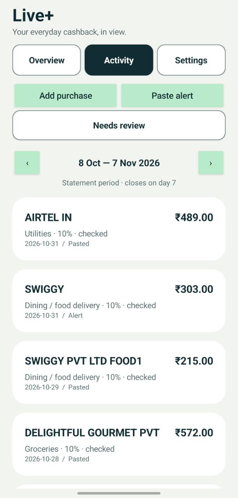

# Live+ Ledger

An offline Android app for tracking spending and estimated cashback on the **HSBC Live+ credit card issued in India**.

See accelerated-category spend, estimated cashback and remaining room under your configured cap. No bank login or full card number is required.

**Android 8.0+ · Native Java · On-device storage · No internet permission**

Independent project; not affiliated with HSBC. Merchant classifications, posting dates and card terms determine actual cashback.

[APK releases](https://github.com/chetanatole/hsbc-liveplus-ledger/releases) · [Installation](docs/INSTALLATION.md) · [MIT License](LICENSE)

## Features

- Accelerated-spend, cashback and remaining-cap dashboard.
- Calendar-month or statement-period tracking and history.
- Light and Dark themes in Settings → Appearance, with Light as the default.
- Capture of new matching HSBC transaction notifications from selected apps.
- Suggested categories, manual corrections and remembered merchant categories.
- Highlighted review counts, duplicate review and full/partial refund linking.
- Calendar date selection for purchases and locally parsed pasted-alert imports.
- Always-accessible Activity actions and saved scroll positions.
- JSON backup export and restore through Android's document picker.

## Screenshots

| Overview | Activity |
| --- | --- |
|  |  |

## Install and set up

Download `LivePlus-Ledger.apk` from a [release](https://github.com/chetanatole/hsbc-liveplus-ledger/releases), or build it from source.

1. Install the APK on Android 8.0 or newer.
2. Enter only your card's last four digits.
3. Configure the reward period and cashback cap.
4. Select the SMS/banking notification source apps and save capture settings.
5. Enable Android notification access.

See [installation and troubleshooting](docs/INSTALLATION.md), including Play Protect and restricted-settings prompts.

## Build and test

APK builds require Windows PowerShell, JDK 17, Android SDK Platform 35 and Build-Tools 35.0.0.

```powershell
./build.ps1 `
  -JavaHome 'C:/path/to/jdk-17' `
  -AndroidJar 'C:/path/to/Android/Sdk/platforms/android-35/android.jar' `
  -BuildTools 'C:/path/to/Android/Sdk/build-tools/35.0.0'
```

Output: `build/LivePlus-Ledger.apk`. Android Studio, an emulator and Gradle are not required.

Run parser and calculation tests with a JDK:

```powershell
./tools/test.ps1 -JavaHome 'C:/path/to/jdk-17'
```

See [development](docs/DEVELOPMENT.md), [device testing](DEVICE-CHECK.md) and [APK releases](docs/RELEASING.md).

## Rewards and privacy

The default accelerated cashback cap is ₹1,200. See [reward assumptions](docs/REWARDS.md) for categories, exclusions and the applicable reference date.

Suggested categories are provisional. Unknown categories and possible duplicates are excluded until reviewed. Refunds require linking to an original purchase.

The app stores data on the device and has no internet permission, analytics, advertising SDKs or SMS inbox access. Read [PRIVACY.md](PRIVACY.md) for notification access, stored fields, backups and deletion.

## Contributing and license

See [CONTRIBUTING.md](CONTRIBUTING.md). Licensed under the [MIT License](LICENSE).
