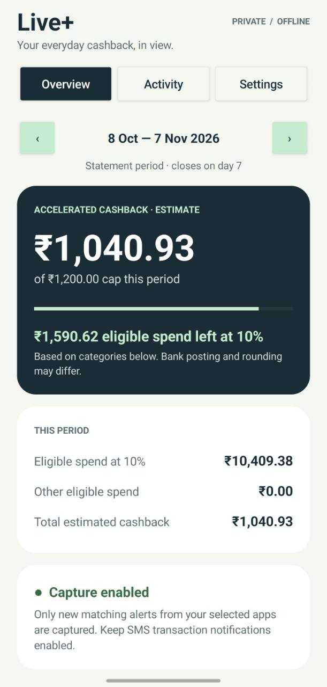
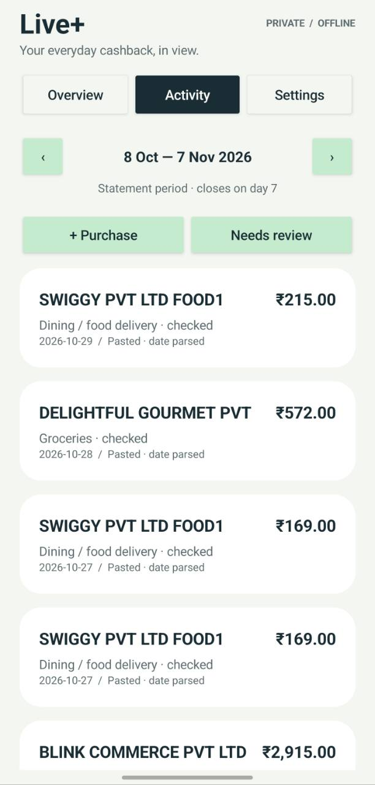

# Live+ Ledger

An offline Android app for tracking spending and estimated cashback on the **HSBC Live+ credit card issued in India**.

See your accelerated-category spend, estimated cashback and remaining room under the configured cap. No bank login or full card number is required.

**Android 8.0+ · Native Java · On-device storage · No internet permission**

Independent personal project; not affiliated with HSBC. Estimates depend on merchant classifications and posting dates and should be checked against your statement.

## Features

- Accelerated-spend, cashback and remaining-cap dashboard.
- Calendar-month or statement-period tracking and history.
- Capture of new matching HSBC transaction notifications from selected apps.
- Suggested categories, manual corrections and remembered merchant categories.
- Possible-duplicate review and full/partial refund linking.
- Manual purchases and locally parsed pasted-alert imports.
- JSON backup export and restore through Android's document picker.

## Screenshots

<!-- SCREENSHOTS:START -->
| Overview | Activity |
| --- | --- |
|  |  |

Screenshots from the installed Android app. The activity shown was imported by pasting alerts; automatic notification capture is still awaiting confirmation.
<!-- SCREENSHOTS:END -->

[Releases and APK downloads](https://github.com/chetanatole/hsbc-liveplus-ledger/releases) · [MIT License](LICENSE)

## Download APK releases

A version-tag release workflow is included. After its private signing secrets are configured, a tag can build, test and publish an APK plus checksum under **Releases**. Users download the APK directly; they do not need the source or build tools. No release is published yet. See [release setup and direct download links](docs/RELEASING.md).

## Install and set up

Build the APK below, transfer it to your phone, and follow [installation and setup](docs/INSTALLATION.md).

1. Enter only the card's last four digits.
2. Set the reward period and cashback cap applicable to your card.
3. Select your SMS/banking notification source apps and save capture settings.
4. Enable Android notification access.
5. Review purchases and correct uncertain categories.

**Play Protect can block this sideloaded app because it declares notification access.** Read [the warning and owner-reported workaround](docs/INSTALLATION.md#play-protect-installation-block) first. Re-enabling scanning does not establish Google approval.

## Build and test

The APK build needs Windows PowerShell, JDK 17, Android SDK Platform 35 and Build-Tools 35.0.0. No Android Studio, emulator or Gradle wrapper is needed. The app has no third-party dependencies.

```powershell
./build.ps1 `
  -JavaHome 'C:/path/to/jdk-17' `
  -AndroidJar 'C:/path/to/Android/Sdk/platforms/android-35/android.jar' `
  -BuildTools 'C:/path/to/Android/Sdk/build-tools/35.0.0'
```

Output: `build/LivePlus-Ledger.apk`. Preserve `.signing/` privately for updates to the existing installed app.

Run parser/calculation tests without the Android SDK:

```powershell
./tools/test.ps1 -JavaHome 'C:/path/to/jdk-17'
```

The test script also runs under PowerShell 7 on Linux/macOS. GitHub Actions runs it on pushes to `main` and pull requests. See [development and first-push instructions](docs/DEVELOPMENT.md).

## Reward assumptions

Defaults checked **31 October 2026**: 10% accelerated cashback with a shared ₹1,200 monthly cap, equivalent to ₹12,000 of eligible spend. See [categories, exclusions and limits](docs/REWARDS.md) and the linked HSBC terms.

Suggested categories count provisionally. Unknown categories, unlinked refunds and possible duplicates are excluded. Changing the cap/period affects all displayed history.

## Privacy and verification

No internet permission, analytics, advertising SDKs or SMS inbox access. Android notification access is broad; filtering occurs locally before transaction fields are saved. Read [PRIVACY.md](PRIVACY.md) before granting access or sharing exports.

- Desktop: 26 parser/calculation checks, APK signature verification and ZIP alignment passed.
- Owner-reported phone result: app installed and appearance reviewed.
- Live transaction-notification capture is **awaiting owner testing**. Other device behaviors, including backup/restore, are not claimed as verified.

Use [DEVICE-CHECK.md](DEVICE-CHECK.md) for further phone checks. Read [CONTRIBUTING.md](CONTRIBUTING.md) before sharing examples or changes. Licensed under the [MIT License](LICENSE).
